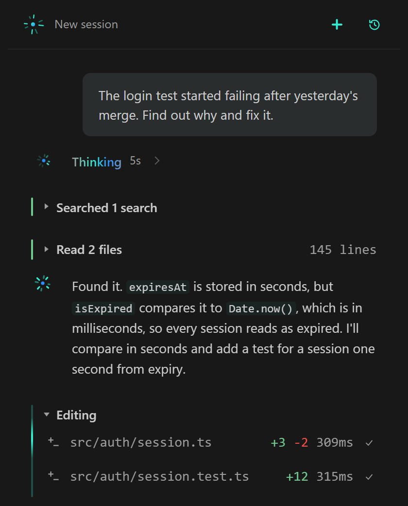

<picture>
  <source media="(prefers-color-scheme: dark)" srcset="assets/header-dark.svg">
  <source media="(prefers-color-scheme: light)" srcset="assets/header-light.svg">
  
</picture>

  
  &nbsp;&nbsp;&nbsp;
  
  &nbsp;&nbsp;&nbsp;
  
  &nbsp;&nbsp;&nbsp;
  

### What I work on

I lead engineering on **[OxCode](https://oxcode.oxlo.ai)**, an AI software engineer for VS Code and the terminal. Version 0.9.0, the public launch, is live on the [Visual Studio Marketplace](https://marketplace.visualstudio.com/items?itemName=oxloai.oxcode-ai) and [Open VSX](https://open-vsx.org/extension/oxloai/oxcode-ai).

My part spans the agent loop, the API gateway behind it, and the evaluation work that measures both. The panel on the right is the real extension, rendered from its own webview.

Before OxCode I built the backend of **[Oxlo.ai](https://oxlo.ai)**, a serverless inference platform serving 45+ models across Azure AI Foundry, AWS Bedrock and our own GPUs.

 

### Results you can check

Both runs are published with their predictions, reports and method in [oxcode-evals](https://github.com/Oxcode-ai/oxcode-evals).

- **SWE-bench Verified: 410 of 500 (82.0%)**, with the agent offline inside each issue's own environment. [See the run](https://github.com/Oxcode-ai/oxcode-evals/tree/main/benchmarks/swe-bench-verified/2026-09-25)
- **Terminal-Bench 2.1: 73 of 89**, our best round. [See the run](https://github.com/Oxcode-ai/oxcode-evals/tree/main/benchmarks/terminal-bench-2.1/2026-09-28)

### Systems I have built

- **Rate limiting** in Redis, atomic per minute, hour and day, with concurrency limits
- **Priority queues** per model, ordered by plan, so a burst waits instead of failing
- **GPU load balancing and autoscaling** across T4 to H100 workers
- **Caching**, from a Redis user cache on the hot path to prompt caching that took Claude calls from zero cache hits to a cached prompt
- **Retries and fallback routing** across model providers in the OxCode gateway

### Selected open source

**[Person Detection, Tracking and Re-Identification](https://github.com/ms-shashank/Person-Detector-and-Tracking)**
YOLOv8 detection, Deep SORT tracking and OSNet re-identification. Keeps a stable ID for each person through occlusion and re-entry.

**[AI Code Debugger](https://github.com/ms-shashank/AI-Code-Debugger)**
A LangGraph workflow with parser, fixer and reviewer roles, iterative reasoning loops and model selection by cost.

**[Universal Document Intelligence Chatbot](https://github.com/ms-shashank/Universal-Document-Intelligence-Chatbot)**
Answers across uploaded documents and live web search, routing each question to the source that can answer it, with citations.

**[PolicyPulse](https://github.com/ms-shashank/-PolicyPulse-Internal-Policy-Compliance-Checker)**
Scans documents and email for policy violations with configurable rules for personal data and confidential material.

### Stack

- **Languages:** Python, TypeScript, JavaScript, SQL, Bash
- **AI:** coding agents, tool calling, RAG, prompt caching, LLM evaluation, LangGraph, PyTorch
- **Models:** DeepSeek, Kimi, Qwen, GLM, Llama, Mistral, Claude and GPT, plus FLUX, Whisper and YOLO
- **Backend and infrastructure:** FastAPI, Postgres, Redis, Docker Swarm, Azure, AWS Bedrock, RunPod
